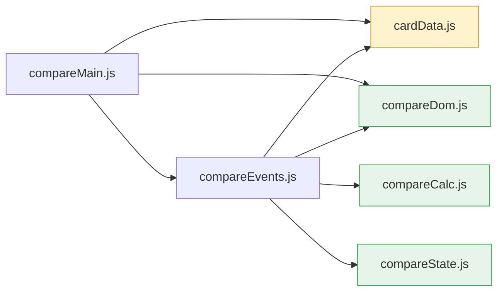
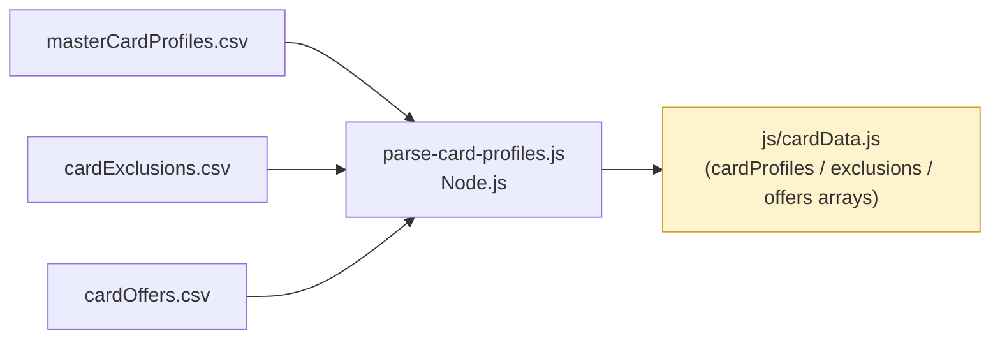
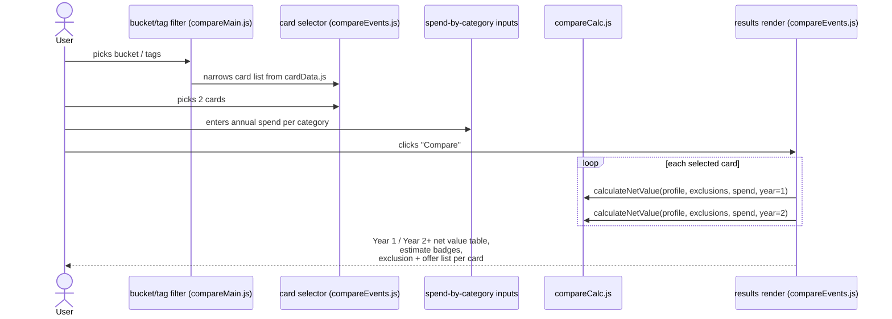
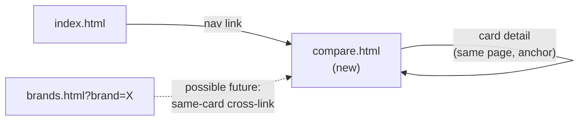

# VouchWise — Card Comparison ("The Real Rate") — Architecture

> New-page addendum, follows the same conventions as `Structure.md` /
> `ARCHITECTURE.md`. This is a companion doc for `compare.html` — the
> existing calculator (`index.html`) and brand guide (`brands.html`) are
> untouched and this page does not share their module graph, same as
> `brands.html` doesn't share `index.html`'s.

---

## 0. Why this isn't a database

The earlier design draft assumed SQL tables (`cards`, `fees`,
`reward_rules`, `exclusions`, `offers`). VouchWise has **no backend and no
database** — everything is a static Cloudflare Pages deploy. This doc
translates that design into the CSV → generated-JS pipeline you already
use for `masterBrands.csv` / `masterCards.csv`:

| SQL draft concept | VouchWise reality |
|---|---|
| `cards` table | `masterCardProfiles.csv` row |
| `fees`, `reward_rules` tables | columns on the same CSV row (1:1 with card) |
| `exclusions` table (1:many) | `cardExclusions.csv`, one row per exclusion, `card_id` column |
| `offers` table (1:many) | `cardOffers.csv`, one row per offer, `card_id` column |
| SQL `JOIN` | `Array.filter(e => e.card_id === id)` in JS at render time |
| DB engine | `parse-card-profiles.js` (Node, run manually, like `parse-brands.js`) |

**Important distinction from `masterCards.csv`**: your existing
`masterCards.csv` answers "how much does this card earn via this voucher
portal" (`rewardType`, `pointValue`, `spendBlock`, `portalMultipliers`).
The new CSVs answer a different question entirely — "what does this card
cost and return over a year, independent of any voucher portal." Same
physical card can appear in both files, linked only by sharing the same
`id` string (e.g. `icici_times_black`) — the two datasets stay decoupled,
same philosophy as `calculator.js` / `customCalc.js` not importing each
other. Don't try to merge them into one CSV; the column shapes don't fit
the same row.

---

## 1. File additions

```
vouchwise/
├── compare.html                    New page — card comparison / true-rate calc
│
├── data/
│   ├── masterCardProfiles.csv      1 row per card: fees, bucket, tags, base rates
│   ├── cardExclusions.csv          1 row per exclusion, card_id FK
│   └── cardOffers.csv              1 row per recurring offer, card_id FK
│
├── parse-card-profiles.js          New Node parser — separate script from
│                                    parse-brands.js (different shape, keep
│                                    the pipelines independent, same reasoning
│                                    as not overloading masterCards.csv)
│
└── js/
    ├── cardData.js                 GENERATED — exports cardProfiles[],
    │                                exclusions[], offers[], tags[].
    │                                DO NOT hand-edit (same rule as data.js
    │                                §4.8) — edit the CSVs, re-run the parser.
    ├── compareCalc.js               Pure net-value math. No DOM. No imports
    │                                from other app modules. Mirrors calculator.js.
    ├── compareState.js              Shared mutable state, this page only.
    │                                No imports. Mirrors state.js.
    ├── compareDom.js                Cached DOM refs. No logic. Mirrors dom.js.
    ├── compareEvents.js             All addEventListener calls. No business logic.
    └── compareMain.js               Entry point.
```

Also required per your own "New page" checklist (Structure.md §13):
add `compare.html` to `sitemap.xml`, add a rewrite rule to `_redirects` if
you want a clean `/compare` URL, and add a link from `index.html`'s nav
(and ideally from each relevant `brands.html` page, once cards cross-link).

---

## 2. Module Dependency Graph



Same isolation rule as your existing graph: **`compareCalc.js` takes
numbers in, returns numbers out — no DOM, no imports.** This is what let
you trust `calculator.js`'s math independent of UI bugs; same payoff
applies here, and it means `compareCalc.js` is unit-testable in isolation
if you ever add tests.

No `customCalc.js`-style second calculator is needed here — there's only
one calculation mode on this page (unlike index.html's portal-compare vs.
coupon-calc split), so no circular-import risk to guard against.

---

## 3. Data Pipeline



No `localStorage` merge step here, unlike `data.js`'s `customBrands` /
`customCards` runtime merge — this feature has no user-added-card concept
(you maintain the card catalog, visitors don't). If that ever changes,
add the merge step then, don't build it speculatively now.

---

## 4. CSV Column Shapes

**`masterCardProfiles.csv`** — one row per card:

```
id, name, issuer, bucket, tags,
joining_fee, annual_fee, waiver_spend_threshold, waiver_condition,
base_reward_multiplier, base_point_value_inr, base_is_estimate,
fees_mitc_url, rewards_mitc_url, last_verified
```

- `tags` — pipe-delimited string (`travel|forex|lounge-access`), split at parse time. Same pattern you'd use if `masterBrands.csv` had multi-category brands.
- `bucket` — one of `entry|mid-tier|high-tier|premier-gated`, validated in the parser (reject unknown values loudly, don't silently pass through — a typo'd bucket should fail the build, not ship silently).
- `*_is_estimate` — `0`/`1`. Rendered in the UI as a badge — non-negotiable per the earlier design decision. **New Inviolable Rule candidate**: any field with a paired `is_estimate` flag must render its badge in every context it appears (card detail page AND comparison table) — a badge only on one is worse than no badge, since it implies the other context is confirmed when it isn't.

**`cardExclusions.csv`** — one row per exclusion:

```
card_id, category, reward_factor, extra_fee_percent, extra_fee_cap_inr, notes, source_clause
```

- `reward_factor` — 0 to 1. Blank means "unconfirmed," not "zero" — the parser should treat empty string differently from `0` (this bit us on the Scapia fuel/utility exclusions, where the real answer was "unknown below threshold," not "excluded").
- `extra_fee_percent` / `extra_fee_cap_inr` — new columns not in the original SQL draft, added because Scapia's MITC revealed exclusions can carry an actual penalty fee, not just a missed reward (rent/wallet-load 1%+GST). Leave blank when not applicable.

**`cardOffers.csv`** — one row per recurring offer:

```
card_id, offer_type, condition_type, spend_threshold, frequency, cap_count, value_description, estimated_value_inr, notes
```

Matches the earlier LDD shape directly — this one translates cleanly since it was already "row-shaped" in the original design.

---

## 5. compareCalc.js — Function Signature

```js
// compareCalc.js — no imports, pure functions only

export function calculateNetValue(cardProfile, exclusionsForCard, spendByCategory, year) {
  let rewardValue = 0;
  for (const [category, amount] of Object.entries(spendByCategory)) {
    const exclusion = exclusionsForCard.find(e => e.category === category);
    const factor = exclusion?.reward_factor ?? 1;
    rewardValue += amount * (factor) * (cardProfile.base_reward_multiplier / 100) * cardProfile.base_point_value_inr;
  }

  const fee = year === 1
    ? cardProfile.joining_fee + (annualSpend(spendByCategory) < cardProfile.waiver_spend_threshold ? cardProfile.annual_fee : 0)
    : (annualSpend(spendByCategory) < cardProfile.waiver_spend_threshold ? cardProfile.annual_fee : 0);

  return {
    rewardValue,
    fee,
    net: rewardValue - fee,
    hasEstimate: cardProfile.base_is_estimate === 1,
  };
}

function annualSpend(spendByCategory) {
  return Object.values(spendByCategory).reduce((a, b) => a + b, 0);
}
```

Deliberately simpler than the earlier Python sketch — no milestone/welcome-benefit handling yet, since that needs its own CSV (`cardMilestones.csv`, `cardWelcomeBenefits.csv`) not yet built. Flagging as a known v1 gap rather than half-building it now.

---

## 6. User Flow



---

## 7. Page Map Update



The `brands.html` link is dotted/possible, not built — cross-linking a
voucher-portal brand page to this page's card detail only makes sense
once both datasets share enough `id`s to make the link reliably useful,
not before.

---

## 8. Open Decision Before Building

Given `Structure.md §1`'s stated priority (distribution over features),
worth explicitly choosing one before writing code:

- **Lean v1**: 4 cards, no bucket/tag filter UI, no offers/exclusions
  display beyond a plain list — just the calculator table. Ships fast,
  tests whether anyone actually uses it.
- **Full v1**: everything in this doc, buckets, tags, exclusion penalties,
  offers — more complete but real build time against a stated priority
  of distribution, not features.

Not picking one now, since it's your call — but the architecture above
supports either; the lean version is just a subset (skip `tags` filtering
logic in `compareMain.js`, skip `cardOffers.csv` for now).