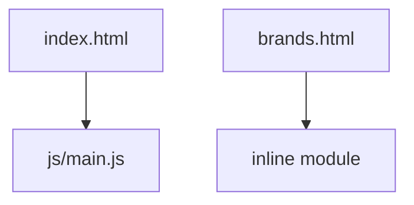
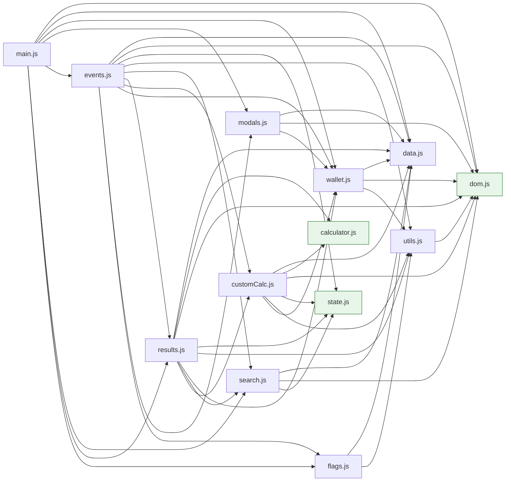

# VouchWise - JavaScript Dependency Map

> **Core Project Scope:** This dependency map defines the active **Voucher Discount & Card Reward Optimizer** module graph. Unfinished card comparison and discovery models are maintained in `docs/WIP/` (Work In Progress).

Solid arrows represent static ES-module imports. Build-time relationships are separate from browser runtime relationships.

## Runtime Entry Points

## Complete Import Graph

## Core Module Table

| File | Imports | Responsibility |
|---|---|---|
| [js/main.js](js/main.js#L1) | `dom`, `data`, `wallet`, `modals`, `events`, `search`, `results`, `flags` | Browser bootstrap and hash preselection |
| [js/events.js](js/events.js#L1) | `data`, `dom`, `state`, `utils`, `search`, `results`, `customCalc`, `wallet`, `modals`, `flags` | Listener registration and event coordination |
| [js/results.js](js/results.js#L1) | `data`, `calculator`, `dom`, `state`, `utils`, `wallet`, `search`, `customCalc` | Eligibility, ranking, result rendering |
| [js/customCalc.js](js/customCalc.js#L1) | `data`, `calculator`, `dom`, `state`, `utils`, `wallet` | Standalone discount calculations |
| [js/wallet.js](js/wallet.js#L1) | `data`, `dom`, `utils` | Wallet persistence and UI |
| [js/search.js](js/search.js#L1) | `data`, `dom`, `state` | Brand autocomplete and selection |
| [js/modals.js](js/modals.js#L1) | `data`, `dom`, `wallet` | Custom card/brand persistence UI |
| [js/flags.js](js/flags.js#L1) | `data`, `utils` | Flag discovery, rendering, removal |
| [js/utils.js](js/utils.js#L1) | `dom` | Shared lookup, validation, rendering, visibility helpers |
| [js/calculator.js](js/calculator.js#L1) | None | Pure multiplier and net-cost calculations |
| [js/data.js](js/data.js#L1) | None | Static datasets and localStorage persistence |
| [js/state.js](js/state.js#L1) | None | Shared mutable calculator state |
| [js/dom.js](js/dom.js#L1) | None | Cached DOM references only |

## WIP Modules

The card-comparison and discovery implementation is not part of the active voucher optimizer. Its archived design notes are retained under [docs/WIP](WIP/). Do not include those modules in the active dependency or deployment graph.

## Inline HTML Module Roots

- [index.html](index.html) has a standalone inline module for the brand-search portal preview and flag handling. It imports data directly and does not inherit `events.js` behavior.
- [brands.html](brands.html) contains its own inline module for the brand guide.

## Dependency Constraints

- Keep `calculator.js`, `state.js`, and `dom.js` free of application-module imports.
- Do not introduce a reverse `customCalc.js -> results.js` dependency; shared behavior belongs in `utils.js` or `calculator.js`.
- Keep comparison data generation separate from the main calculator dataset.
- Treat inline HTML modules as separate roots when changing shared behavior.
