# VouchWise - Repository Architecture

This document describes the implemented repository as of November 2026. The JavaScript import graph is documented separately in [JavaScriptDependencyMap.md](../).

> **Core Project Scope:** This document defines the **Voucher Discount & Card Reward Optimizer** (Voucher price, portal discount, convenience fee, denomination flooring, card reward calculation, card and portal eligibility, wallet selections, ranking, custom cards, custom brands, standalone discount calculator, scraped catalog generation, live catalog refresh, and HITL/pre-flight pipeline).
> Unfinished card-comparison and category-discovery models are maintained in `docs/WIP/` (Work In Progress) and are excluded from active voucher optimizer scope.

## 1. Project Understanding

### Stack

- Static HTML pages with browser-native ES modules.
- Vanilla JavaScript; no frontend framework and no backend application server.
- Tailwind CSS 3.4.4, loaded from the CDN by the main pages. [src/input.css](../) contains the local Tailwind source directives.
- Cloudflare Pages static assets behind [_worker.js](../), configured by [wrangler.jsonc](../).
- Browser `localStorage` for wallet selections, custom cards, custom brands, and flagged discounts.
- External affiliate destinations represented in [routes.json](../).

### Architecture style

VouchWise is a static web application with native browser ES modules. It is not a microservice or event-driven backend. Each HTML page owns a browser entry point; calculation and rendering execute in the browser. Browser persistence (`localStorage`) is the only user-specific data layer.

The active runtime is the **Voucher Discount & Card Reward Optimizer**:
- **Main Calculator**: [index.html](../) plus `main.js`, `events.js`, `results.js`, `customCalc.js`, `calculator.js`, `cardRules.js`, `wallet.js`, `search.js`, `modals.js`, `flags.js`, and `data.js`.
- **Brand Guide & Direct Route Routing**: [brands.html](../) with native module integration.

*(Note: Unfinished card comparison and discovery models are preserved under `docs/WIP/` for future reference).*

## 2. High-Level Architecture

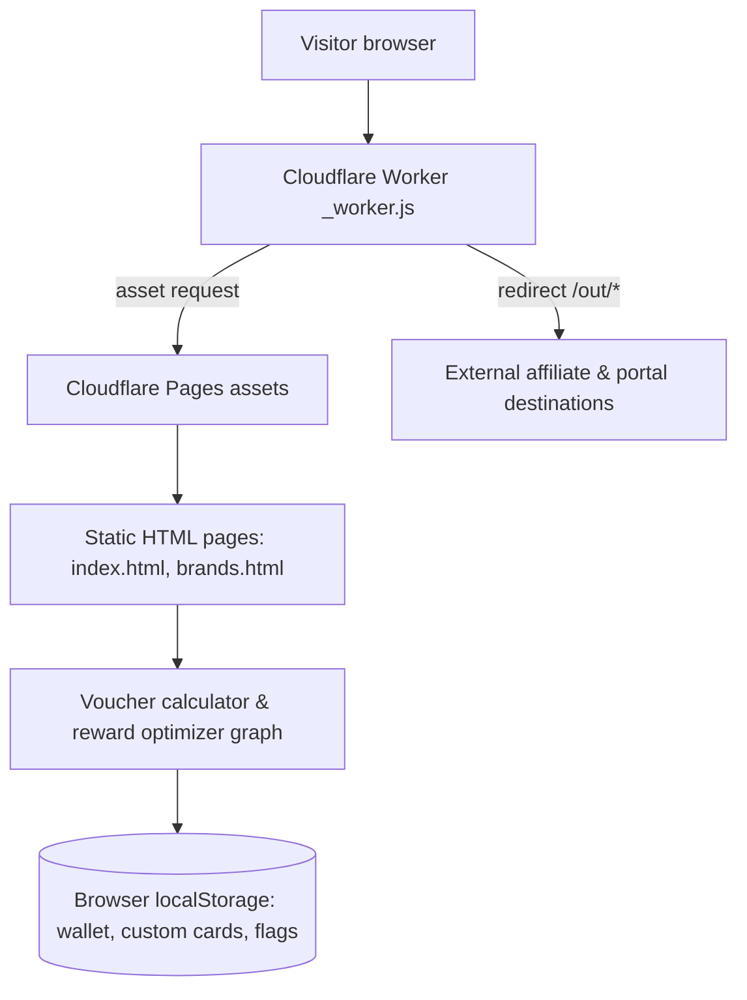

The worker is a routing boundary, not a business-service boundary. It redirects known affiliate paths from [routes.json](../) and delegates other requests to Pages assets.

## 3. Folder-Structure Map

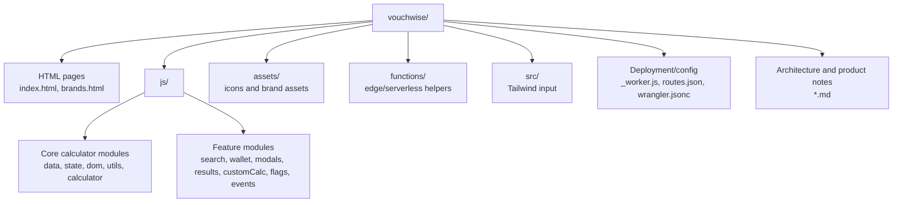

At the repository root, the HTML files are page templates, `js/` contains browser and Node modules, `assets/` contains static media, `src/` contains Tailwind input directives, and the worker/configuration files define deployment and redirect behavior.

## 4. Page and Entry-Point Map

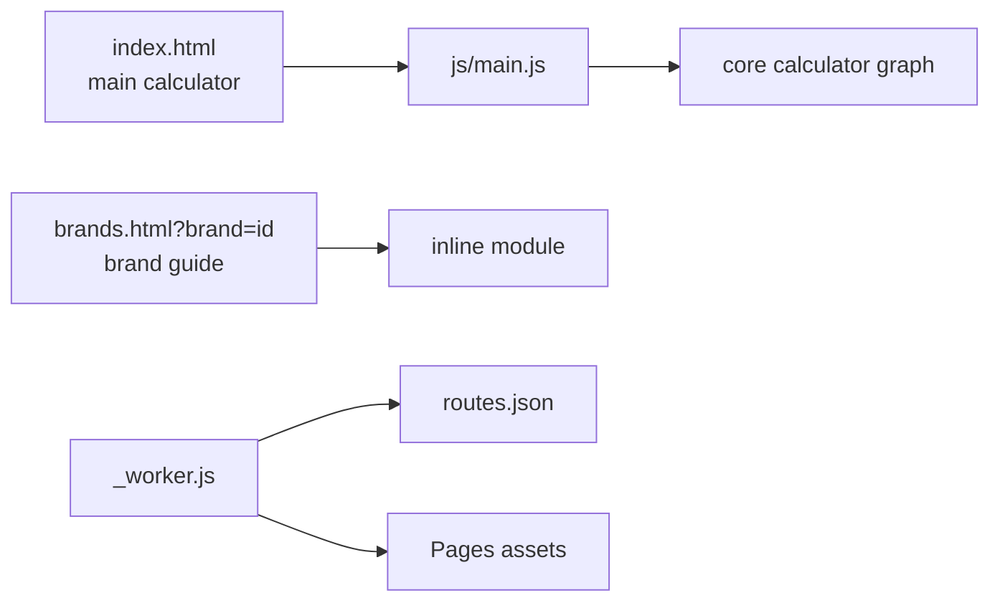

## 5. Core Voucher Calculator

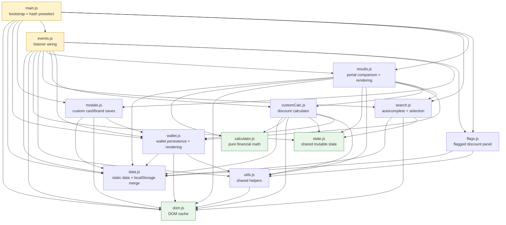

`events.js` is the composition root for user interaction. `results.js` owns portal eligibility, calculation orchestration, ranking, and rendering. `customCalc.js` owns the standalone discount flow. `calculator.js` is pure and imports no application modules.

## 6. Data Pipeline

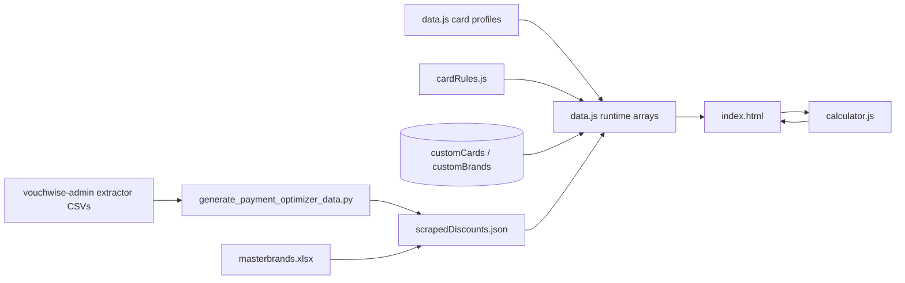

The main calculator merges built-in card and brand data with custom records in browser storage. Live portal discounts and fees are loaded from `scrapedDiscounts.json`. Card-comparison and discovery models are not part of this pipeline and remain WIP under `docs/WIP/`.

## 8. Data Flow and Control Flow

The main calculation path is:

```text
Page load
  -> main.bootstrap()
  -> renderWalletUI(), applyBankDefaults(), initEvents(), renderFlaggedDiscounts()
  -> user selects brand through search.selectBrand()
  -> user saves card IDs through wallet.saveWalletIds()
  -> events click handler calls results.handleCalculate()
  -> results.getEligibleResults()
  -> calculator.calculateTrueNetMetricsWithFlooring() per eligible card/portal
  -> results.groupAndSortResults()
  -> results.renderResults()
  -> optional /out/* request is redirected by _worker.js using routes.json
```

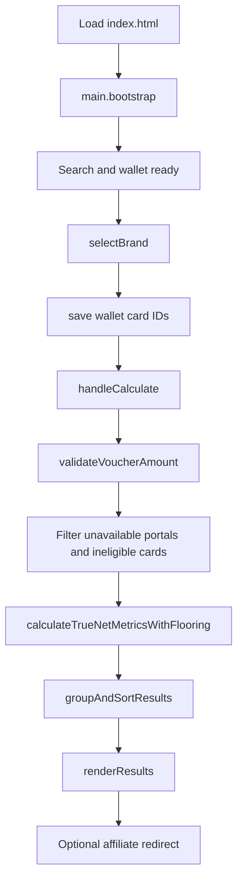

## 9. Key Workflow Sequences

### Find the best voucher deal

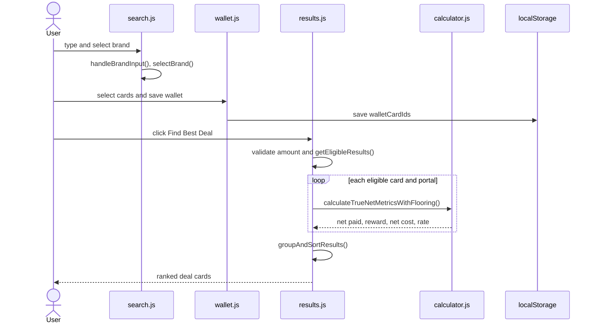

### Run the custom discount calculator

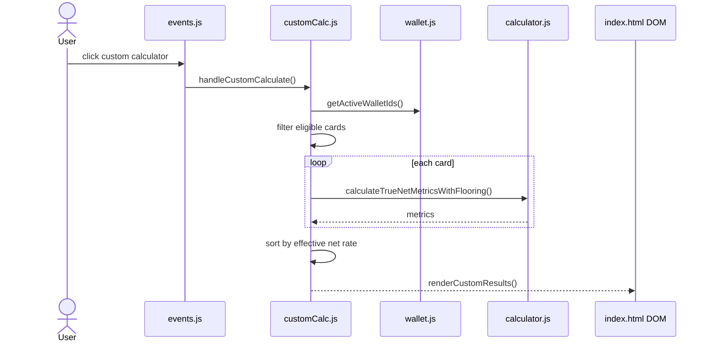

## 10. UML Views

### Module/class view

The code is function-oriented rather than class-oriented, so this UML view models modules and public responsibilities.

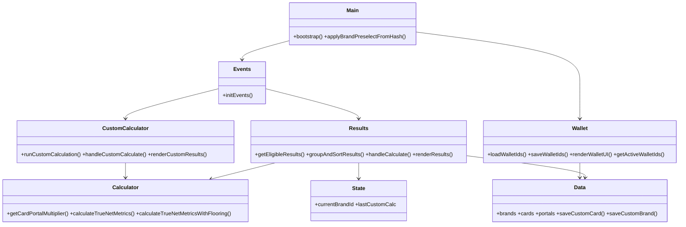

### Use cases

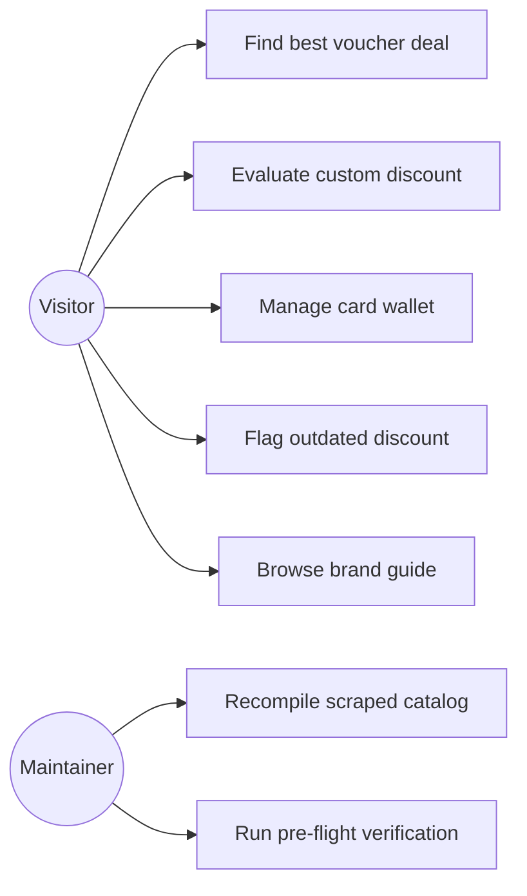

### Main activity

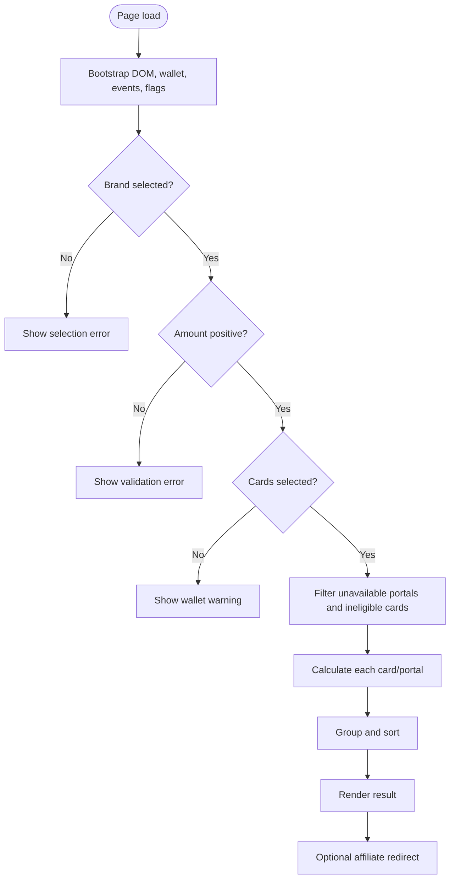

### Main state diagram

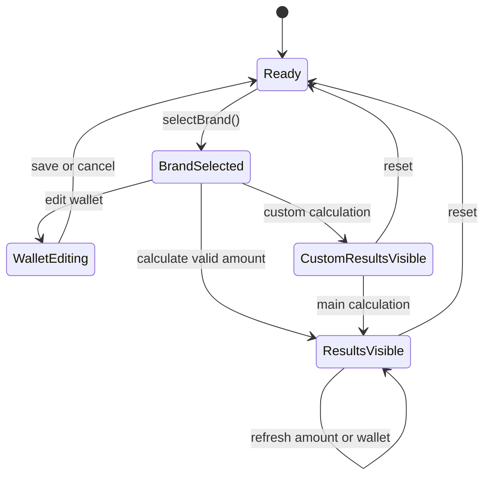

## 11. Feature-to-File Mapping

| Feature | Files and symbols |
|---|---|
| Bootstrap | [js/main.js](../), `bootstrap`, `applyBrandPreselectFromHash` |
| DOM cache | [js/dom.js](../), `dom` |
| Static/custom data | [js/data.js](../), `brands`, `cards`, `portals`, `saveCustomCard`, `saveCustomBrand` |
| Brand search | [js/search.js](../), `handleBrandInput`, `selectBrand`, `renderCategoryBrands` |
| Wallet | [js/wallet.js](../), `loadWalletIds`, `saveWalletIds`, `renderWalletUI`, `renderWalletChipBar` |
| Custom card/brand UI | [js/modals.js](../), `applyBankDefaults`, `handleSaveCard`, `handleSaveBrand` |
| Portal comparison | [js/results.js](../), `getEligibleResults`, `groupAndSortResults`, `handleCalculate`, `renderResults` |
| Financial math | [js/calculator.js](../), `getCardPortalMultiplier`, `calculateTrueNetMetricsWithFlooring` |
| Custom discount flow | [js/customCalc.js](../), `runCustomCalculation`, `handleCustomCalculate` |
| Shared helpers | [js/utils.js](../), `validateVoucherAmount`, `getBrandById`, `getPortalById` |
| Flags | [js/flags.js](../), `getAllFlags`, `renderFlaggedDiscounts`, `removeFlag` |
| Event wiring | [js/events.js](../), `initEvents` |
| Affiliate routing | [_worker.js](../), [routes.json](../) |

## 12. Important Invariants

- Portal eligibility is determined by `isCardPortalEligible(card, portal)`; discount-only issuer portals remain eligible even when accelerated rewards are zero.
- Unavailable brand portals must be filtered before calculation.
- UI-facing flows use `calculateTrueNetMetricsWithFlooring`, not the raw calculation function.
- `localStorage` keys such as `walletCardIds`, `customCards`, `customBrands`, and `flag:<brandId>:<portalId>` are compatibility contracts.
- `customCalc.js` must not import `results.js`; shared behavior belongs in `utils.js` or `calculator.js`.
- The inline preview modules in [index.html](../) and [brands.html](../) are separate module roots and do not inherit `events.js` behavior.
