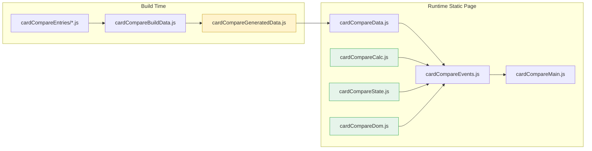

# VouchWise — Card Comparison ("The Real Rate") — Architecture

> **Current Status**: **Deferred / Unlinked Preview**
> 
> CardCompare (`compare.html`) is deployed as an unlinked preview. It is directly accessible via its static URL (`/compare.html`) through Cloudflare Pages / Worker asset fallback, but it is **deliberately NOT linked from main navigation (`index.html`)** and **NOT listed in `sitemap.xml`**.
>
> **Core Strategic Decision**:
> - Keep CardCompare as an unlinked preview for now.
> - Do not delete it, do not add it to main navigation, and do not promote it publicly.
> - Treat catalog expansion beyond the current 9 cards and any public launch as backlog work until the calculation model and source-verification workflows are mature and sustainable to maintain.

---

## 0. Architectural Reality: Modular Entry Files vs Legacy CSV/DB Drafts

Earlier planning drafts considered relational SQL databases (`cards`, `fees`, `reward_rules`, `exclusions`) or monolithic CSV files (`masterCardProfiles.csv`, `cardExclusions.csv`, `cardOffers.csv`).

In the actual implementation, VouchWise uses **modular ES module card profile files**:
- Each credit card is defined in its own file under `vouchwise/cardCompareEntries/` (e.g., `cardCompareEntryHdfcRegaliaGold.js`).
- Each entry file exports three objects: `cardProfile`, `exclusions` array, and `offers` array.
- An assembly script `vouchwise/js/cardCompareBuildData.js` (`node cardCompareBuildData.js`) compiles all entry files into a single static generated file: `vouchwise/js/cardCompareGeneratedData.js`.
- `vouchwise/js/cardCompareData.js` imports and re-exports the generated data while providing runtime helpers (`getExclusionsForCard`, `getOffersForCard`, `BUCKET_FILTER_LABELS`, `cardMatchesBucketFilter`, `scenarios`).

### Why Modular Entry Files Over CSVs
1. **Isolated maintenance**: Editing exclusions or offers for one card touches exactly one file, eliminating merge conflicts and accidental changes to other cards.
2. **Schema flexibility**: Offers and exclusions have variable structures (e.g. network variants, caps, fee clauses) that fit JavaScript objects far better than wide or sparsely populated CSV tables.
3. **Diff readability**: Git diffs clearly highlight specific bank policy changes per card.

---

## 1. File Structure & Catalog

```
vouchwise/
├── compare.html                         Unlinked preview page (The Real Rate comparison calculator)
│
├── cardCompareEntries/                  Hand-maintained source of truth (1 file per card)
│   ├── cardCompareEntryAuIxigo.js
│   ├── cardCompareEntryFederalScapia.js
│   ├── cardCompareEntryHdfcInfiniaMetal.js
│   ├── cardCompareEntryHdfcMillennia.js
│   ├── cardCompareEntryHdfcRegaliaGold.js
│   ├── cardCompareEntryHdfcSwiggyOrange.js
│   ├── cardCompareEntryHsbcPremier.js
│   ├── cardCompareEntryHsbcVisaPlatinum.js
│   └── cardCompareEntryIciciTimesBlack.js
│
├── js/
│   ├── cardCompareBuildData.js          Node builder: reads cardCompareEntries/*.js -> cardCompareGeneratedData.js
│   ├── cardCompareGeneratedData.js      GENERATED file — aggregated cardProfiles[], exclusions[], offers[]
│   ├── cardCompareData.js               Re-exports generated data + scenario presets & bucket filters
│   ├── cardCompareCalc.js               Pure net-value financial math. No DOM, no external dependencies
│   ├── cardCompareState.js              Shared mutable state for compare.html
│   ├── cardCompareDom.js                Cached DOM references
│   ├── cardCompareEvents.js             Event handling, URL syncing, and UI rendering
│   └── cardCompareMain.js               compare.html entry point
```

### Current Catalog (9 Cards)
The catalog currently contains exactly 9 card profiles across different tiers:
1. **AU ixigo** (`au_ixigo`): Zero-forex, travel-oriented entry.
2. **Federal Scapia** (`federal_scapia`): Zero-forex, travel reward card (supports Visa / RuPay variants).
3. **HDFC Infinia Metal** (`hdfc_infinia_metal`): Super-premium rewards card.
4. **HDFC Millennia** (`hdfc_millennia`): Mid-tier cashback card.
5. **HDFC Regalia Gold** (`hdfc_regalia_gold`): Premium travel/lifestyle card.
6. **HDFC Swiggy** (`hdfc_swiggy_orange`): Co-branded dining/grocery card.
7. **HSBC Premier** (`hsbc_premier`): Premier relationship banking card.
8. **HSBC Visa Platinum** (`hsbc_visa_platinum`): Entry-level cashback/points card.
9. **ICICI Times Black** (`icici_times_black`): Premium lifestyle/dining card.

---

## 2. Module Dependency Graph



**Architectural Principle**: Like `calculator.js` in the main voucher application, `cardCompareCalc.js` is strictly isolated:
- Pure mathematical functions with no DOM manipulation and no module imports.
- Takes plain numbers and profile objects as input, returns immutable calculation objects.
- Completely unit-testable in isolation.

---

## 3. Maintenance Model: Verified Sources & Manual Review

1. **Source-Backed Facts Only**:
   - Every card profile stores official citation links: `fees_mitc_url` (Most Important Terms & Conditions / Key Fact Statement) and `rewards_mitc_url` (Rewards Program Terms).
   - If a benefit, rate, or waiver condition cannot be traced directly to an official bank document or schedule of charges, it must not be added as a confirmed fact.
2. **Explicit Verification Date**:
   - Each card profile tracks a `last_verified` date (ISO 8601 string) indicating when the MITC was last inspected.
3. **Manual Review Over Loose Scraping**:
   - Bank terms, exclusion lists, and MCC penalty fee policies are published in complex legal PDFs with frequent mid-year revisions.
   - Scraping bank websites introduces severe risk of hallucinated terms or missed caveats. Changes are reviewed manually by inspecting official bank notifications.

---

## 4. Calculation Scope & Known Limitations

`cardCompareCalc.js` evaluates a transparent, spend-based net ledger:

$$\text{Net Value} = \text{Base Reward Value} + \text{Eligible Cash Offers} - \text{Total Fees} - \text{Category Surcharges}$$

### What IS Modeled
1. **Base Reward Rate**:
   - Rate calculated as: $\text{Spend} \times \left(\frac{\text{base\_reward\_multiplier}}{100}\right) \times \text{base\_point\_value\_inr} \times \text{category\_factor}$.
   - Handles network variants (e.g. Scapia Visa vs RuPay rates) via `resolveBaseRate()`.
2. **Category Exclusions & Extra Surcharges**:
   - Zero-reward categories (e.g. rent, fuel, wallet loads) where `reward_factor = 0`.
   - Category-specific penalty fees (e.g. 1% + GST on rent or wallet loads) capped at `extra_fee_cap_inr` where applicable.
3. **Card Fees & Waivers**:
   - Year 1 includes `joining_fee`.
   - Year 2+ applies `annual_fee` unless total annual spend meets or exceeds `waiver_spend_threshold`.
   - Handles structurally zero-fee cards (`annual_fee: 0`).
4. **Cash-Equivalent Milestone & Welcome Offers**:
   - Welcome benefits (Year 1 flat benefits).
   - Annual or periodic spend milestones (e.g. bonus points or statement credit upon clearing spend threshold).

### What IS NOT Modeled (Crucial Code Limitations)
The calculator output is strictly a **conservative base-rate floor**, NOT a true ceiling:
1. **Accelerated Multiplier Categories**:
   - Does NOT model category accelerators or 5X/10X portal multipliers (e.g. HDFC SmartBuy 5X/10X on Regalia Gold/Infinia, Scapia 20% travel portal rewards, Millennia 5% cashback on partner merchants).
2. **Issuer Caps**:
   - Does NOT model per-transaction caps (e.g. AU ixigo complimentary insurance transaction caps) or multi-category shared statement-cycle caps (e.g. Times Black 5,000 points monthly pool).
3. **Real Per-Period Spend History**:
   - The calculator takes annual category totals. It does not track actual monthly or billing-cycle spend variance.
   - For quarterly or monthly milestones, it approximates occurrences assuming perfectly even spend across periods: $\text{impliedPeriodSpend} = \frac{\text{annualSpend}}{\text{periodsPerYear}}$. If that average meets the threshold, all periods are counted; otherwise zero.
4. **Voucher Face Value Excluded from Ledger**:
   - Merchant gift cards, dining discount coupons, and conditional vouchers (`value_type: 'voucher'`) are displayed in the "What you get" breakdown but **excluded** from the numeric ledger total because their face value is not guaranteed cash-equivalent.

---

## 5. UI Disclosure of Uncertainty & Transparency

CardCompare enforces strict honesty in its presentation (`cardCompareEvents.js` and `compare.html`):

1. **`ESTIMATE` Badges**:
   - Rendered visibly alongside card names whenever `cardProfile.base_is_estimate === 1` or when base rates/point values are approximations.
2. **Prominent Warning Banners**:
   - `dataInsufficient`: When a card's base rate or point value has not yet been sourced (e.g. Infinia or Swiggy base points without portal context), the UI displays: *"Base reward rate or point value not yet sourced for this card — reward figures below are incomplete, not zero-value."*
   - `hasUnknownCategoryFactor`: Warns if any spend category has an unconfirmed reward factor.
   - Point Valuation Warning: Warns user when redemption values represent an estimate (e.g. HSBC ₹0.25 conservative floor).
3. **"n/a" Output**:
   - In the spend comparison table, cards with incomplete data render `"n/a"` rather than displaying an inaccurate `₹0` or fabricated total.
4. **Line-by-Line Formula Transparency**:
   - Renders the exact math for each category: $\text{Spend} \times \text{Rate}\% \times \text{Factor} \times \text{Point Value} = \text{Rupee Total}$.
5. **Categorized Exclusions Display**:
   - Explicitly partitions exclusions into:
     - **Zero rewards on**: Categories confirmed to earn 0%.
     - **Unconfirmed**: Categories where bank terms are ambiguous.
     - **Extra fee applies**: Categories subject to bank surcharges.

---

## 6. Vendor Offers vs Enduring Card Benefits

The data model and calculator maintain an explicit separation between enduring card features and third-party promotions:

| Attribute | Enduring Card Benefits (`card_benefit`) | Third-Party Vendor Offers (`vendor_offer`) |
|---|---|---|
| **Nature** | Structural features of the card (e.g. lounge access, base milestones) | Promotional merchant partnerships (e.g. EazyDiner, BookMyShow discounts) |
| **Expiry Date** | None (`valid_until: null`) | Mandatory `valid_from` and `valid_until` |
| **Lapse Handling** | Never marked expired | Automatically flagged by `isOfferExpired()` |
| **Ledger Contribution** | Counted if cash-equivalent and spend threshold met | **₹0 if expired**; excluded immediately upon passing `valid_until` |
| **UI Presentation** | Displayed in standard benefit list | Badged with expiry date (`Vendor offer · valid until YYYY-MM-DD`) or `<span class="vendor-badge expired">EXPIRED — needs update</span>` |
| **Maintenance Signal** | Reviewed during annual MITC audit | `isOfferExpiringSoon()` flags offers within 30 days of lapsing |

---

## 7. Deliberate Avoidance of a Crowned "Best Card" Badge

`compare.html` intentionally refuses to declare a "Winner" or award a "Best Card" badge:

1. **Credibility Hazard**: With several cards lacking confirmed point redemption values, and with accelerated 5X/10X categories unmodeled, crowning a single "winner" would mislead visitors and destroy user trust.
2. **Subjective Value Weights**: A cardholder spending heavily on rent or forex will have radically different outcomes than an everyday grocery shopper; net value depends entirely on individual spend breakdowns.
3. **Scenario Presets as Starting Points, Not Endorsements**:
   - Scenarios (`frequent-flyer`, `everyday-shopper`, etc.) populate realistic category inputs and suggest a relevant starting pair.
   - The comparison itself always executes through the transparent net ledger so all caveats and exclusions remain completely visible.

---

## 8. Deployment & Access Status

- **URL**: `https://vouchwise.in/compare.html`
- **Routing**: Static asset served via Cloudflare Pages / Worker `env.ASSETS` fallback.
- **Navigation**: Deliberately omitted from `index.html` navigation and footer.
- **Sitemap**: Deliberately omitted from `sitemap.xml`.
- **Search Engines**: Unlinked and unpromoted. Serves as an internal preview and testing surface.

---

## 9. Backlog & Launch Gates

For the roadmap, launch gates, acceptance criteria, and next steps, see the companion backlog document:
[vouchwise-admin/docs/backlog/CARD_COMPARE_BACKLOG.md](../../../vouchwise-admin/docs/backlog/CARD_COMPARE_BACKLOG.md).
